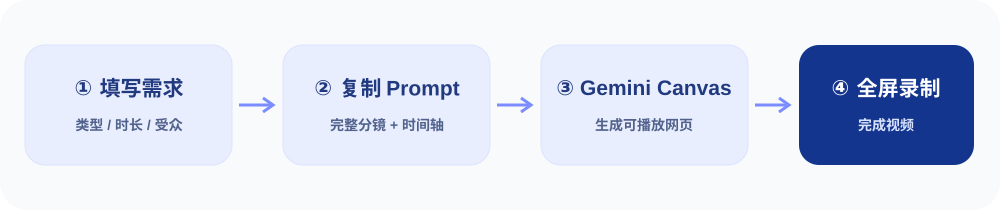

# 🎬 Gemini Canvas Video Kit

### 只用 Gemini 网页版，把一句话变成一支可以直接录屏的视频

**不用 CLI · 不用 API Key · 不用安装插件 · 中文优先 · 开箱即用**

[打开提示词工作室](./index.html) · [30 秒完整演示](./examples/launch-showcase.html) · [5 分钟入门](./docs/quickstart.md) · [English](./README.en.md)

<!-- andy-pdf-edition:start -->
## 精美 PDF 电子书

[**免费下载《Gemini Canvas 视频制作指南》**](pdf/Gemini-Canvas-Video-Kit-guide.pdf) · [直接下载 PDF](https://github.com/AIPMAndy/Gemini-Canvas-Video-Kit/raw/refs/heads/main/pdf/Gemini-Canvas-Video-Kit-guide.pdf)

**24 页 · A5 手机阅读版 · 可点击目录 · 0.63 MB**  
整理日期：2026-11-13。包含完整实操正文、案例、模板与原始来源；平台规则与价格沿用原资料的核查日期。

**作者与服务（广告）**：AI 酋长 Andy · 个人微信 **AIPMAndy** · [个人官网](https://metaver.vip/) · [公司官网](https://www.a6no1.cn/)。免费教程可直接使用，咨询与合作自愿选择。
<!-- andy-pdf-edition:end -->

> **项目状态：v0.1 实际可用的首版。** 已提供离线运行的提示词生成器和本地网页演示；尚未声称它已在每个 Gemini 版本、设备或浏览器中完成实测。Gemini 网页端功能会随地区和版本变化。

## 🌐 在线网站 / Live Website

- **体验网站**：https://aipmandy.github.io/Gemini-Canvas-Video-Kit/ （首次使用需先启用 GitHub Pages）
- **产品 Demo**：https://aipmandy.github.io/Gemini-Canvas-Video-Kit/examples/launch-showcase.html
- **部署流水线**：[Actions · Publish Gemini Canvas Video Kit](https://github.com/AIPMAndy/Gemini-Canvas-Video-Kit/actions/workflows/pages.yml)

### 访问网站 404 怎么处理？

公开仓库和 `index.html` 存在，并不代表 GitHub Pages 已启用。首次需要仓库管理员操作一次：

1. 打开 [Settings → Pages](https://github.com/AIPMAndy/Gemini-Canvas-Video-Kit/settings/pages)。
2. 在 **Build and deployment → Source** 选择 **GitHub Actions**（本项目已配置独立部署工作流，不要再使用分支发布模式）。
3. 打开 [Actions → Publish Gemini Canvas Video Kit](https://github.com/AIPMAndy/Gemini-Canvas-Video-Kit/actions/workflows/pages.yml)，运行 **Run workflow**；或者再次推送 `main` 触发。
4. 等待工作流绿色成功后，再访问网站。若失败，查看运行日志，不要把仓库提交成功误认为网站已经上线。

之后每次提交 `main`，都会先运行 `python3 scripts/smoke_test.py` 检查入口页面与内部链接，再自动发布；没有成功的部署记录时，不对外宣称网站已上线。

## 为什么做

市面上很多“AI 做视频”项目最后仍要配置 API、安装 CLI、处理剪辑和音频。而很多产品介绍、模拟操作、知识科普、信息可视化，本来就可以在一个浏览器网页里变成 **连续、有时间轴、有镜头、有字幕** 的作品。

本项目把 **Gemini 网页版 Canvas 当作视频制作器**：让它直接写一个有播放时间轴的 HTML 页面，自己在 Canvas 预览里播放。你只需要全屏录屏即可发布。这里的“生成视频”主要是**代码驱动的网页动画视频**，不等于 Gemini/Veo 的写实文生视频。

## 只需四步

1. 打开本项目的 `index.html`（或者上线后的 GitHub Pages 网站）。
2. 选择视频类型、时长、比例，填写产品名、目标用户、一个核心卖点；点击 **复制完整 Prompt**。
3. 在 [gemini.google.com](https://gemini.google.com/) 新建对话，选择 **Canvas**，粘贴 Prompt，要求直接生成可预览的网页。
4. 检查首屏、操作细节、镜头连接和字幕；点击网页的播放/全屏，使用系统录屏获取成片。

## 能做什么

| 模式 | 适合谁 | 输出重点 |
| --- | --- | --- |
| 产品宣传片 | AI 工具、SaaS、独立开发者 | 痛点 → 真实或标注为模拟的 UI 操作 → 价值 → CTA |
| 连续 UI Demo | 产品经理、开发者、销售 | 连续的点击、输入、加载、结果反馈，不用跳步 |
| 知识科普 | 教师、知识博主 | 概念 → 类比 → 动画拆解 → 结论 |
| 数据故事 | 商业分析、报告解读 | 数据来源与口径、图表变化、关键结论 |
| 社媒短视频 | 小红书、Reels、Threads、X | 前 3 秒钩子、过程、可执行的收获 |
| 课程演示 | 在线教育、内部培训 | 操作步骤、重点标注、复盘 |

## 这个项目实际包含

- **可用的网站** `index.html`：自动计算分镜时长，生成可直接粘贴到 Gemini Canvas 的完整 Prompt；支持复制、导出 `.md`，无需联网调用模型。
- **可播放的 30 秒成片 Demo** `examples/launch-showcase.html`：一个独立 HTML，展示镜头切换、模拟 UI、鼠标轨迹、自动输入、字幕、播放/暂停/重播/全屏。**演示 UI 为虚构示意，不代表真实产品截图或实测。**
- **15 秒科普 Demo** `examples/knowledge-explainer.html`：动画解释步骤的短视频页面。
- **提示词与修复包** `templates/`：六类视频模板、总控提示词、画面修复、节奏修复、UI 真实性修复。
- **教程与验收表** `docs/`：录屏、音频限制、15 项质检、常见问题和能力边界。

## 视频质量基线

**完整视频 ≠ 一堆好看卡片。** 必须符合：

- 一个明确受众、一个核心价值主张；**字幕不是旁白的简单重复**。
- 有明确时间轴，镜头自动衔接，点击播放后可从头到尾看完。
- 产品 UI 有真实的状态因果：输入 → 执行 → 等待 → 结果；不能几秒钟跳过所有操作。
- 以实际产品截图、真实可录制界面为证据时，不得编造；模拟页面标注“概念演示”。
- 字体大小、音量、字幕安全区适合 16:9 或 9:16。
- 不依赖外部 CDN、API Key、Node.js、ffmpeg 或第三方图片，就能运行基础版本。

## 关于声音与导出，必须先说清楚

- **Canvas 并非官方承诺的一键 MP4 导出器。** 本项目默认通过系统录屏得到视频。网页内 `MediaRecorder`/WebCodecs 可作为以后增加的可选功能，兼容性因浏览器和嵌入环境而异。
- 浏览器 `speechSynthesis` 可以尝试朗读，但声音、时长、声线与录屏音轨捕获都**无法保证稳定**。默认优先保证准确分镜、可读字幕和可录屏画面；旁白可在录屏后配音，或自行使用系统支持的朗读功能。
- Veo/生成式写实镜头属于另一条路线，不属于本项目基础使用流程。

详见 [音频与录屏](./docs/audio-and-recording.md) 和 [能力边界](./docs/limitations.md)。

## 网站上线方式（GitHub Pages）

将仓库公开并把文件提交到 `main`，然后打开 **Settings → Pages → Build and deployment → Deploy from a branch → main / (root)**。站点会包含 `index.html` 和 `examples/`。这里只提供静态网页，不要求使用任何服务端或账户。

> GitHub Pages 的实际发布地址以 GitHub 配置界面显示为准，不预设已经上线。

## 原始资料与参考

- [Google Gemini Canvas 官方介绍](https://gemini.google/us/overview/canvas/) — 官方明确支持生成可运行、可共享的应用/网页以及代码动画。
- [Gemini Apps Help: Canvas](https://support.google.com/gemini/answer/16047321) — Canvas 的启动、分享、导出能力说明。
- [motionvideohq/awesome-gemini-4-argon-motion-design](https://github.com/motionvideohq/awesome-gemini-4-argon-motion-design) — 视频代码动画案例，第三方作品，请遵守原作者许可。
- [IG-ABHINAV/canvas-to-video](https://github.com/IG-ABHINAV/canvas-to-video) — 可选浏览器录制参考，非基础依赖。
- [ziyunfei/render-video](https://github.com/ziyunfei/render-video) — 浏览器 WebCodecs 导出研究参考，非基础依赖。

这些链接仅作学习资料；本项目的代码与模板独立编写，不复制第三方项目源码或未授权素材。

## 作者与合作

由 **AI 酋长 Andy / 星觉科技** 发起，服务内容创作者与 AI 产品团队。

- [个人网站](https://metaver.vip/)
- [企业网站](https://www.a6no1.cn/)
- [GitHub 主页](https://github.com/AIPMAndy)

本项目与 Google / Gemini **无官方隶属或合作关系**。Gemini 为 Google 的商标。

欢迎提交问题、分享自己用 Gemini 网页版 Canvas 生成的**真实、可验证**视频案例。

**License: MIT**
